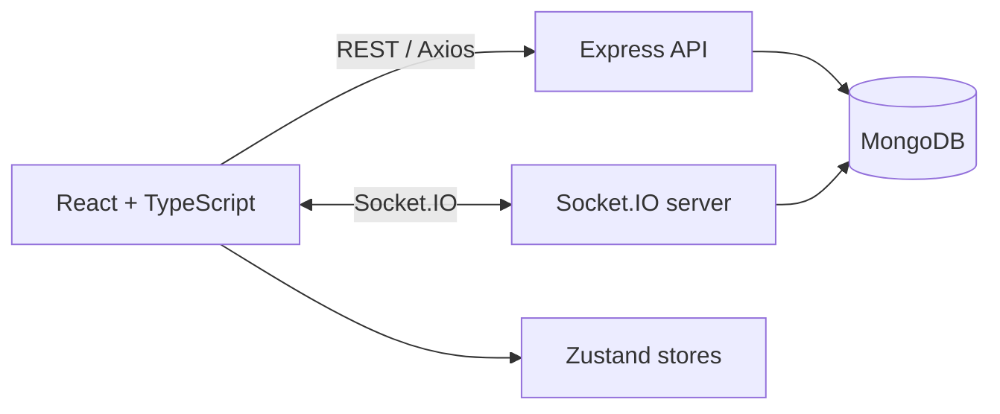

# ChatChit

ChatChit is a full-stack real-time messaging application with direct and group conversations, friend requests, presence, unread counters, and cursor-based message history.

<div style="display: flex; gap: 10px;">
  
  
</div>

## Features

- Access and rotating refresh-token authentication
- Direct and group messaging through Socket.IO rooms
- Friend request workflow: send, receive, accept, and decline
- Live presence with multiple-tab support
- Unread counters and read receipts
- Cursor-based message pagination
- Optimistic delivery with sending, sent, failed, and retry states
- Typing indicators and automatic reconnect synchronization
- User search, responsive layouts, dark mode, and emoji picker
- Conversation-level authorization for REST and Socket.IO

## Architecture



The frontend uses React, TypeScript, Vite, Zustand, Tailwind CSS, and Radix UI. The backend uses Node.js, Express, Socket.IO, Mongoose, JWT, and MongoDB.

## Getting started

Requirements:

- Node.js 22
- MongoDB locally or through a hosted provider

Install dependencies:

```bash
cd backend
npm ci

cd ../frontend
npm ci
```

Create the backend environment file:

```bash
cd backend
cp .env.example .env
```

On PowerShell, use `Copy-Item .env.example .env` instead. Replace every example value before starting the server. Never commit `.env`.

The frontend reads these variables from its environment files:

```env
VITE_API_URL=http://localhost:5001/api
VITE_SOCKET_URL=http://localhost:5001
```

Start both applications in separate terminals:

```bash
# backend
cd backend
npm run dev

# frontend
cd frontend
npm run dev
```

The API health endpoint is available at `GET /health`.

## API overview

All routes except authentication require a bearer access token.

| Area | Routes |
| --- | --- |
| Authentication | `POST /api/auth/signup`, `/signin`, `/refresh`, `/signout` |
| Users | `GET /api/users/me`, `/search?username=...` |
| Friends | `GET /api/friends`, `/requests`; `POST /api/friends/requests` |
| Conversations | `GET/POST /api/conversations`; `GET /:id/messages`; `PATCH /:id/seen` |
| Messages | `POST /api/messages/direct`, `/group` |

Important socket events:

- Server events: `online-users`, `new-message`, `read-message`, `new-group`, `typing-start`, `typing-stop`
- Client events: `join-conversation`, `typing-start`, `typing-stop`

The server verifies membership before serving conversation messages, updating read state, accepting group messages, or joining a socket room.

## Quality checks

```bash
cd backend
npm test
npm audit --omit=dev

cd ../frontend
npm run lint
npm test
npm run build
```

GitHub Actions runs backend and frontend tests, production dependency audits, lint, and the production build on pushes and pull requests.

## Project structure

```text
backend/
  src/controllers/   Request handlers
  src/middlewares/   Authentication and authorization
  src/models/        Mongoose schemas
  src/socket/        Socket.IO server
  test/              Node test runner suites
frontend/
  src/components/    UI and feature components
  src/services/      REST clients
  src/stores/        Zustand state
  src/types/         Shared frontend types
```

## Roadmap

- Group administration and membership management
- Image attachments
- Message reactions, editing, deletion, and search
